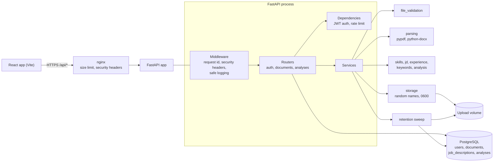

# Architecture



## Request flow: analyze a resume

1. `POST /documents` - authenticate, rate-limit, read the body in chunks (stop at 5 MB), validate type and content, test-parse the file, store it under a random name, insert a `documents` row with an `expires_at`.
2. `POST /analyses` - authenticate, load the document **only if it belongs to the caller**, re-extract the text, run the matcher, store the job description and the JSON report, return the report.
3. `GET /analyses` / `GET /analyses/{id}` - history, always filtered by `user_id`.

## Design decisions

| Decision | Reason |
|---|---|
| Services are plain functions with no FastAPI imports | Easy to unit test; the rule-based matcher can later be swapped for an NLP model behind the same `analyze()` signature |
| Resume text is **not** stored in the database | Less sensitive data at rest; the file is re-parsed when needed and deleted on schedule |
| `Document.stored_name` is a random hex string, `original_filename` is display-only | No user input ever reaches a filesystem path |
| Analyses cascade-delete with their document | Reports contain resume snippets, so they share the document's lifetime |
| JSONB report column (JSON on SQLite) | Report shape can evolve (`report_version`) without migrations |
| Matching uses a versioned JSON skills taxonomy | Transparent and testable; every decision can be traced to a rule |

## Folder layout

```
backend/app/
  main.py            app, middleware, lifespan (create tables, retention sweep)
  database.py        engine, session, Base
  core/              config, security (argon2, JWT), rate_limit, logging
  models/            SQLAlchemy models
  schemas/           Pydantic request/response models and the report schema
  api/               routers and dependencies
  services/          file_validation, parsing, storage, skills, sections, jd,
                     experience, keywords, analysis, retention
  data/skills.json   skill taxonomy (131 skills)
backend/evaluation/  labelled dataset and metrics script
backend/tests/       pytest suite
frontend/            React + Vite UI, nginx config
```
