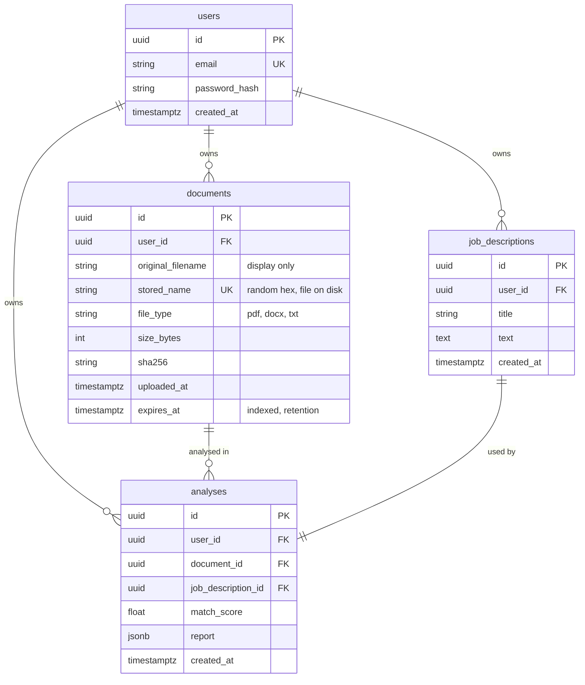

# Database schema



## Notes

- **IDs are UUIDs**, so URLs cannot be guessed by counting.
- **Cascades:** deleting a user removes their documents, job descriptions and analyses. Deleting a document removes its analyses, and each analysis removes its job description. The ORM relationships perform this cascade (so it also works on SQLite); the foreign keys carry `ON DELETE CASCADE` as a second layer on PostgreSQL.
- **Indexes:** `users.email` (unique), `documents.user_id`, `documents.expires_at`, `analyses.user_id`, `analyses.document_id`, `analyses.created_at`.
- **What is not stored:** the extracted resume text, the original upload's content type, and any contact details. The report contains short resume lines that mention matched skills, so it is treated as personal data and shares the document's retention.
- **Migrations:** tables are created with `Base.metadata.create_all()` at startup. For a long-lived deployment, add Alembic (see `known-limitations.md`).

## Report JSON (`analyses.report`)

```json
{
  "report_version": 1,
  "match_score": 66.7,
  "required_coverage": 80.0,
  "preferred_coverage": 0.0,
  "matched_skills":  [{"name": "Python", "category": "Languages", "importance": "required"}],
  "missing_skills":  [{"name": "Kubernetes", "category": "Cloud & DevOps", "importance": "required"}],
  "additional_skills": [{"name": "Git", "category": "Cloud & DevOps"}],
  "missing_keywords": ["payment", "ledger"],
  "experience": {"estimated_years": 3.2, "required_years": 3, "meets_requirement": true},
  "relevant_experience": ["Built REST APIs with FastAPI and PostgreSQL ..."],
  "warnings": []
}
```

Score = `100 * (2 * required matched + 1 * preferred matched) / (2 * required total + 1 * preferred total)`.
